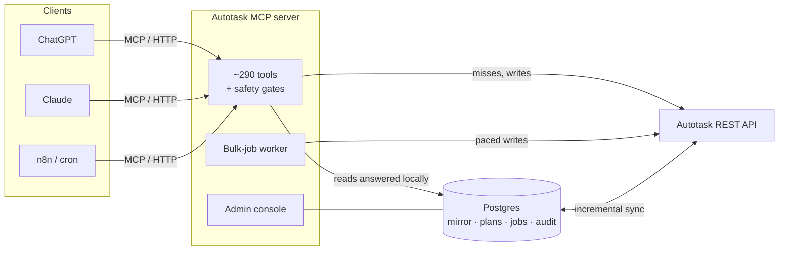

# Autotask MCP Server

[](https://github.com/GDSTechnology/autotask-mcp/actions/workflows/ci.yml)
[](https://github.com/GDSTechnology/autotask-mcp/releases/latest)
[](https://opensource.org/licenses/Apache-2.0)
[](https://nodejs.org/)

**Run an MSP's Autotask from chat and automation — safely.**

A [Model Context Protocol](https://modelcontextprotocol.io/) server for Kaseya Autotask PSA. ChatGPT, Claude,
n8n and any other MCP client get **~290 tools** across tickets, time, projects, contracts, billing, CRM and
reporting — plus the parts that make it safe to run against a live tenant: a Postgres mirror that answers
most reads without touching Autotask, change plans that a person approves by hash, paced bulk jobs, tenant-wide
throttling and an admin console.

**Docs site:** [gdstechnology.github.io/autotask-mcp](https://gdstechnology.github.io/autotask-mcp/) — guides and the full tool reference.

It started as a fork of [WYRE-AI/autotask-mcp](https://github.com/WYRE-AI/autotask-mcp) and is now the
production automation layer for an Autotask MSP (ChatGPT + n8n + Claude), hardened against real tenant data.

---

## Contents

- [What it does](#what-it-does)
- [How it fits together](#how-it-fits-together)
- [Safety model](#safety-model)
- [Quick start](#quick-start)
- [Production deployment](#production-deployment)
- [Configuration](#configuration)
- [Autotask API limits](#autotask-api-limits)
- [Documentation](#documentation)
- [Development](#development)
- [Credits & license](#credits--license)

## What it does

| Area | Highlights |
|---|---|
| **Tickets & service desk** (39) | Search, create, update (partial `PATCH` — never blanks fields), notes, attachments and the originating email, charges, checklists, ticket history and who-changed-what, `get_ticket_by_number`, move a ticket to another company with its routing in one write, an interactive ticket card in MCP Apps hosts. |
| **Time & billing** (26) | Time entries (incl. bulk and "log my time"), billing items approve-and-post, expense reports, timesheet-lock aware errors, `my_day`. |
| **Projects** (51) | Projects, phases, tasks, predecessors, notes; generate a labour plan and build a project from it. |
| **Contracts & financial** (41) | Contracts, services, bundles, blocks, adjustments, charges, quotes, opportunities, invoices — including the contract writes the API makes awkward (adjustments verified by effect). |
| **Vendor billing reconciliation** (21) | Import vendor invoices (Pax8 first), map them to contracts, find what isn't billed / billed wrong / priced under cost, a pricing policy (retail uplift with a margin floor), pre-invoice checks, customer price-change notices, and change plans that fix it. → [VENDOR_BILLING](docs/VENDOR_BILLING.md) |
| **Companies & contacts** (19) | Search / create / update with name guards (no "Gmail" or "Hi John" companies), duplicate finders, a **safe merge** workflow (ID-only plans of Autotask UI steps, verified afterwards) and **bulk cleanup** of placeholder companies and junk contacts. → [MERGE](docs/MERGE.md) |
| **Reports** (26) | Unbilled work / revenue leakage, block-hour usage, SLA compliance, ticket throughput, project P&L, contract recurring revenue, time-entry compliance, activity without time, inventory reorder / stale stock. |
| **Audit & activity** (10) | A ticket-history index, an activity feed, resource daily audits; actors classified as person / integration / system so automation is never mistaken for a technician. |
| **Products & catalog** (31) | Products, services, bundles; duplicate products, catalog standardisation plans. |
| **Service calls, to-dos, CIs, resources** (36) | Dispatching, company to-dos, configuration items with entitlement, resources and roles. |
| **Webhooks** (7) | Create and manage Autotask outbound webhooks; signed delivery to n8n. → [N8N_WEBHOOKS](docs/N8N_WEBHOOKS.md) |
| **Platform** | Postgres mirror tools (`shadow_query`, `shadow_aggregate` — 0 Autotask calls), `get_backpressure` for dispatchers, `report_gap` (agents report what's missing), `execute_tool` / `list_category_tools` for clients with a stale tool list. |

Counts are tools per area; the exact list is in [`src/handlers/tool.definitions.ts`](src/handlers/tool.definitions.ts).

## How it fits together



- **Postgres mirror** (optional, recommended): 18 entities — tickets, notes, time entries, tasks, projects,
  companies, contacts, contracts, services, billing items, invoices and more — kept current by watermark /
  window sync and a nightly **mirror check** that re-reads a random sample and repairs differences. In
  production it answers about **80% of reads** with no Autotask call. → [POSTGRES](docs/POSTGRES.md)
- **Admin console** (optional): server health, Autotask API usage (whole tenant vs this MCP), who is calling,
  reads per entity, mirror status, feature switches without a restart, a **Requests** page for missing
  capabilities, **Bulk jobs** and **When does the team work?** (activity per hour, by person / integration).
  → [ADMIN](docs/ADMIN.md)

## Safety model

The server assumes it is talking to a live production tenant and to clients that sometimes guess.

| Guard | What it does |
|---|---|
| **Partial writes** | Updates `PATCH` only the fields given. A `PUT` replaces the whole record and blanks what it leaves out — the typed tools never do that. |
| **Dry runs & confirmation** | Destructive and bulk tools default to a dry run and need an explicit confirm; descriptions say so (CI enforces it). |
| **Change plans** | Pricing, contract, catalog and merge changes are built as a **plan with a hash**, reviewed, then executed (or turned into UI steps); executions are re-run safe and can be reverted where the API allows. |
| **Bulk jobs** | Mass changes are prepared from the mirror, **approved by hash** by a person, run a **canary** first, then a paced worker writes — slower in business hours, nothing in **quiet hours**, backing off from 40% tenant usage and stopping at 65%. Records with history are excluded; for placeholder cleanups every email address is checked tenant-wide so real people are kept. |
| **Read-only switch** | One console switch stops every write — tools and background jobs. |
| **Login protection** | A rejected login pauses all calls; repeated failures hold the tenant until an administrator retries, so a bad secret can't lock the API user. |
| **Throttling** | A 429 starts a local cooldown (no retry storms), at most 2–3 concurrent calls per endpoint, `get_backpressure` tells dispatchers ok / slow / stop. → [THROTTLING](docs/THROTTLING.md) |
| **Company 0** | The tenant's own company is protected from rename, reclassification and inactivation. |
| **Operation log** | Every write is recorded per tool call (who, what, which records), with durable idempotency keys. |

## Quick start

**Claude Desktop** — build the bundle from source (`npm ci && npm run build && npm run pack:mcpb`), open the
resulting `.mcpb` file in the repo root, and enter your Autotask username, secret and integration code.

**Claude Code:**

```bash
claude mcp add autotask-mcp -e AUTOTASK_USERNAME=api-user@example.com -e AUTOTASK_SECRET=your-secret -e AUTOTASK_INTEGRATION_CODE=your-code -- npx -y github:GDSTechnology/autotask-mcp
```

**Docker (HTTP, for ChatGPT / n8n / remote clients):**

```bash
docker run -d --name autotask-mcp -p 8080:8080 -e AUTOTASK_USERNAME=api-user@example.com -e AUTOTASK_SECRET=your-secret -e AUTOTASK_INTEGRATION_CODE=your-code --restart unless-stopped ghcr.io/gdstechnology/autotask-mcp:latest
```

Clients connect to `http://<host>:8080/mcp` (MCP Streamable HTTP); `GET /health` returns the version, API usage and backpressure.

**From source:**

```bash
git clone https://github.com/GDSTechnology/autotask-mcp.git && cd autotask-mcp
npm ci && npm run build
node dist/entry.js        # stdio; MCP_TRANSPORT=http node dist/index.js for HTTP
```

Create the API user in Autotask (Admin → Resources, license type *API User*, an API-tracking integration code)
with the security level your tools need. The API zone is detected from the username.

## Production deployment

Releases are cut by semantic-release on every merge to `main` and published to
`ghcr.io/gdstechnology/autotask-mcp` (`:latest` and the version tag).

Run it as a docker-compose service next to Postgres (see [DEPLOY.md](DEPLOY.md) for the full runbook:
layout, env, verify, rollback). Updating is one command on the host — install it once from the image:

```bash
docker run --rm --entrypoint cat ghcr.io/gdstechnology/autotask-mcp:latest /app/deploy/update-autotask-mcp.sh > /usr/local/bin/update-autotask-mcp && chmod +x /usr/local/bin/update-autotask-mcp
```

```bash
update-autotask-mcp
```

It touches only the Autotask MCP service: pulls, keeps the previous image as `:rollback`, runs database
migrations, restarts, waits for `/health` and prints the version — and refuses while a bulk job is preparing.

- **Postgres layer** (mirror, plans, bulk jobs, audit): [POSTGRES](docs/POSTGRES.md)
- **Admin console** (guided setup wizard, Cloudflare Tunnel walkthrough): [ADMIN](docs/ADMIN.md)
- **Behind an MCP gateway** (credentials per request via headers, acting-user headers): [MIGRATION_GUIDE](docs/MIGRATION_GUIDE.md)

## Configuration

| Variable | Default | |
|---|---|---|
| `AUTOTASK_USERNAME` / `AUTOTASK_SECRET` / `AUTOTASK_INTEGRATION_CODE` | — | API user credentials (required in `env` auth mode) |
| `AUTOTASK_API_URL` | auto-detected | Override the zone URL |
| `AUTH_MODE` | `env` | `gateway`: credentials come from request headers |
| `AUTOTASK_IMPERSONATION` | `off` | `on`: writes are recorded as the identified requesting user |
| `MCP_TRANSPORT` / `MCP_HTTP_PORT` / `MCP_HTTP_HOST` | `stdio` / `8080` / `0.0.0.0` | Transport |
| `MCP_PG_ENABLED`, `MCP_PG_*` | off | Postgres layer → [POSTGRES](docs/POSTGRES.md) |
| `MCP_PG_SHADOW_*` | | Mirror sync interval, budget, pause threshold (85%), serving reads |
| `MCP_ADMIN_ENABLED`, `MCP_ADMIN_PORT` | off / `8090` | Admin console → [ADMIN](docs/ADMIN.md) |
| `MCP_BULK_SLOW_AT_PCT` / `MCP_BULK_STOP_AT_PCT` | `40` / `65` | Bulk-job back-off by tenant API usage |
| `AUTOTASK_MAX_CONCURRENT_PER_ENDPOINT` | `2` | Concurrent calls per endpoint (Autotask allows 3) |
| `LOG_LEVEL` / `LOG_FORMAT` | `info` / `simple` | `json` for production |

Most operational settings (read-only switch, mirror serving, caller names, actor registry, notifications to
Discord / Teams / Slack) are changed live in the console. The full list is in [DEPLOY.md](DEPLOY.md) and [ADMIN](docs/ADMIN.md).

## Autotask API limits

Autotask allows **10,000 requests per hour per database** — shared by *every* integration on the tenant — and
adds **0.5 s per call from 50% usage and 1 s from 75%**; past the limit it answers 429. It also allows only
**3 concurrent requests per integration per endpoint**.

What this server does about it:

- answers most reads from the Postgres mirror and an HTTP cache (0 Autotask calls);
- a 429 starts a local cooldown — calls fail fast with "do not retry" instead of extending the penalty;
- background work (mirror sync, bulk jobs) checks tenant usage and yields first; bulk jobs keep quiet hours;
- the console shows tenant usage vs this MCP's share, and who is calling.

To see which **other** integration uses the hour, Autotask's own **API Activity By Hour** report (Admin →
Extensions & Integrations) breaks calls down per API user. → [THROTTLING](docs/THROTTLING.md)

## Documentation

| Doc | For |
|---|---|
| [DEPLOY.md](DEPLOY.md) | Deploy, verify, rollback; environment reference |
| [docs/ADMIN.md](docs/ADMIN.md) | The admin console: setup, pages, switches, bulk jobs, notifications |
| [docs/POSTGRES.md](docs/POSTGRES.md) | The Postgres layer: mirror, sync modes, mirror check, migrations |
| [docs/THROTTLING.md](docs/THROTTLING.md) | Limits, cooldowns, backpressure — and how a dispatcher should react |
| [docs/INTEGRATION.md](docs/INTEGRATION.md) | Building on the MCP from n8n / ChatGPT: result shapes, caller identity, gates, gotchas |
| [docs/VENDOR_BILLING.md](docs/VENDOR_BILLING.md) | Vendor invoice reconciliation, pricing policy, the monthly billing process |
| [docs/MERGE.md](docs/MERGE.md) | Safe company / contact merges and bulk placeholder / junk-contact cleanup |
| [docs/N8N_WEBHOOKS.md](docs/N8N_WEBHOOKS.md) | Receiving signed Autotask webhooks in n8n |
| [docs/DESIGN.md](docs/DESIGN.md) | Architecture and design decisions |
| [docs/ITIL-ALIGNMENT.md](docs/ITIL-ALIGNMENT.md) | Aligning an Autotask tenant with ITIL 4, with the MCP as the enforcement layer |
| [docs/DEVELOPER_GUIDE_MCP_AUTOTASK.md](docs/DEVELOPER_GUIDE_MCP_AUTOTASK.md) | Patterns and gotchas of the Autotask REST API |
| [docs/MIGRATION_GUIDE.md](docs/MIGRATION_GUIDE.md) | Local → gateway (hosted) deployment |
| [docs/mapping.md](docs/mapping.md) | ID-to-name enrichment of results |
| [CHANGELOG.md](CHANGELOG.md) | Every release (generated) |

## Development

```bash
npm ci
npm run build       # TypeScript → dist/
npm test            # ~1,600 tests (Jest)
npm run lint
npm run dev         # watch mode
```

- **Local Postgres** for the mirror and console: `dev-postgres/local-db.ps1 up` then `… migrate` (Docker).
- **Branches → PRs → `main`.** CI runs tests on Node 20 and 22, lint, the destructive-tool warning check and a
  token-free Docker build. Conventional commits drive the version (`feat:` minor, `fix:` patch).
- **Adding a tool:** definition in `src/handlers/tool.definitions.ts` (with its category — a parity test
  enforces it), handler, tests that assert the **filter sent upstream**, not just the rows returned.
- What the tenant taught us (API quirks, read-only fields, entities that aren't queryable) is kept in the
  *Learnings* section of [CLAUDE.md](CLAUDE.md) — read it before touching the Autotask client.

Contributions: see [CONTRIBUTING.md](CONTRIBUTING.md) and the [Contributor License Agreement](CLA.md).

## Credits & license

Built on the original **Autotask MCP Server** by **[WYRE Technology](https://github.com/wyre-technology)** and
**Aaron Sachs ([@asachs01](https://github.com/asachs01))** and its contributors, published at
[WYRE-AI/autotask-mcp](https://github.com/WYRE-AI/autotask-mcp) — the baseline this work is founded on; see
[NOTICE](NOTICE). Uses the [Model Context Protocol](https://modelcontextprotocol.io/) and the public
[GDSTechnology/autotask-node](https://github.com/GDSTechnology/autotask-node) fork (no private registry or token needed to build).

| | | |
|---|---|---|
| <a href="https://github.com/asachs01"></a> | [@asachs01](https://github.com/asachs01) | Original author & upstream maintainer |
| <a href="https://github.com/Baphomet480"></a> | [@Baphomet480](https://github.com/Baphomet480) | CLI bin fix (upstream) |

Licensed under the **Apache License 2.0** — see [LICENSE](LICENSE) and [NOTICE](NOTICE).
Issues and ideas: [GitHub Issues](https://github.com/GDSTechnology/autotask-mcp/issues).
